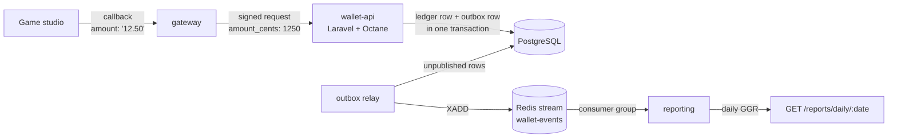

# Seamless Wallet

A casino-style **seamless wallet**: game studios call it on every bet and win, and it moves the money.
Three services, built the way money-handling systems have to be built — every movement exactly once,
never lost, never invented, and consistent under concurrent load.

| Service | Stack | Responsibility |
| --- | --- | --- |
| **wallet-api** | Laravel 13, PHP 8.4, Octane on FrankenPHP, PostgreSQL | The ledger. Applies bets and wins atomically, idempotently, under row locks |
| **gateway** | Node.js 22, Fastify | Receives studio callbacks, translates and signs them, retries safely |
| **reporting** | Node.js 22, Redis Streams | Consumes wallet events and maintains daily gross gaming revenue |



## Run it

```bash
docker compose up -d --build
```

That starts PostgreSQL, Redis, the wallet API on Octane, the outbox relay, the gateway and the
reporting service, runs migrations, and seeds one player with €100.00.

```bash
# a bet, through the gateway, in the studio's format
curl -s -X POST localhost:3000/callbacks/bet -H 'content-type: application/json' \
  -d '{"txn":"PRG-1001","player":1,"round":"R-1","amount":"12.50"}'
# {"status":"OK","txn":"PRG-1001","balance":"87.50","duplicate":false}

# the studio retries the same callback (timeouts happen) — charged once, flagged as a duplicate
curl -s -X POST localhost:3000/callbacks/bet -H 'content-type: application/json' \
  -d '{"txn":"PRG-1001","player":1,"round":"R-1","amount":"12.50"}'
# {"status":"OK","txn":"PRG-1001","balance":"87.50","duplicate":true}

# a win
curl -s -X POST localhost:3000/callbacks/win -H 'content-type: application/json' \
  -d '{"txn":"PRG-1002","player":1,"round":"R-1","amount":"30.00"}'
# {"status":"OK","txn":"PRG-1002","balance":"117.50","duplicate":false}

# a bet larger than the balance
curl -s -X POST localhost:3000/callbacks/bet -H 'content-type: application/json' \
  -d '{"txn":"PRG-1003","player":1,"round":"R-2","amount":"999.00"}'
# {"status":"INSUFFICIENT_FUNDS","txn":"PRG-1003","balance":"117.50"}

# a few seconds later, the reporting service has the day's numbers
curl -s localhost:3001/reports/daily/$(date -u +%F)
# {"date":"…","bets_cents":1250,"wins_cents":3000,"ggr_cents":-1750,"transactions":2}
```

## Tests

```bash
docker compose run --rm wallet-api php artisan test   # 49 tests: wallet, outbox, withdrawals, cashback, queues, security
(cd gateway && npm test)                              # 12 tests
(cd reporting && REDIS_URL=redis://localhost:6379 npm test)
```

CI runs all three on every push, plus code style (Pint) and a build of every Docker image.

## The interesting parts

### 1. The wallet never loses or invents money

`wallet-api/app/Services/Wallet/WalletService.php`

- **One database transaction** for the balance update and the ledger row — both are saved or neither is.
- **`SELECT … FOR UPDATE`** on the wallet row: a second request for the same wallet waits until the
  first one commits, so two simultaneous bets can't both read the same starting balance.
- **Idempotency on the provider's transaction id**, checked once before the lock and again inside it,
  because two identical requests can arrive at the same moment. A retry returns the original result;
  the same id with a different player, type or amount is rejected with 409, never treated as a retry.
- **Money as integer cents** everywhere. Never floats.

You can watch what happens without these rules — ten OS processes betting on the same wallet at once:

```bash
docker compose run --rm wallet-api php artisan demo:race naive         # ❌ money appears or disappears
docker compose run --rm wallet-api php artisan demo:race pessimistic   # ✅ row lock
docker compose run --rm wallet-api php artisan demo:race optimistic    # ✅ version column + retry
```

```
naive        ❌ inconsistent: 6600 cents lost or created out of thin air
pessimistic  ✅ consistent: the balance matches the ledger and every accepted bet
optimistic   ✅ consistent: the balance matches the ledger and every accepted bet
```

### 2. Events are never lost — the transactional outbox

Publishing to Redis directly after a commit has a gap: if the process dies between the commit and the
publish, the event is gone, and if you publish *before* the commit, other services can hear about a bet
that was then rolled back.

So the event is written to an `outbox_messages` table **in the same transaction as the money**, and a
separate relay (`php artisan outbox:relay`) publishes committed rows to the `wallet-events` stream.

- The event exists **if and only if** the money moved.
- Redis can be down for an hour: events wait in PostgreSQL and go out when it's back.
- The relay locks rows with `FOR UPDATE SKIP LOCKED`, so several relays can run side by side.
- Delivery is **at least once**, by design. If the relay dies after publishing but before marking a row,
  that row goes out again — and consumers deduplicate. Pretending exactly-once delivery exists is how
  numbers quietly drift.

### 3. The gateway retries, and that's only safe because of #1

`gateway/src/app.js`

- Studios send `"12.50"`. Converting that with `parseFloat(x) * 100` gives `1249.9999999999998` for some
  values, so amounts are converted on the string itself (`gateway/src/money.js`).
- Every forwarded request is signed — HMAC-SHA256 of `timestamp.body` — and the wallet API rejects
  anything unsigned, tampered with, or older than five minutes (replay protection). A test checks the
  Node signature byte for byte against what PHP's `hash_hmac` produces.
- When the wallet is briefly unavailable, the gateway retries with exponential backoff, re-signing
  each attempt. Retrying a bet is normally dangerous; here it's safe because the wallet is idempotent on
  the transaction id. Errors that won't fix themselves (insufficient funds, validation) are never retried.

### 4. Reporting counts every event exactly once

`reporting/src/consumer.js`

- A **Redis Streams consumer group**: several reporting instances can share the stream without
  processing the same entry twice.
- Entries are acknowledged only **after** they're applied. A crash leaves them pending, and on restart
  the consumer re-reads its own pending entries before taking new ones.
- If an instance dies for good, its replacement takes over whatever it left pending (`XAUTOCLAIM`
  after a minute idle), so no event is stranded under a consumer name that will never start again.
- "Have I seen this event?" and "add it to the report" happen in **one Lua script**, atomically. As two
  separate calls, a crash between them would either lose the event or count it twice.

### 5. Octane on FrankenPHP

The API runs on Laravel Octane with FrankenPHP: the framework boots once per worker and stays in memory,
instead of bootstrapping on every request as PHP-FPM does.

Long-lived workers change what's safe to write:

- **Anything stored on a singleton survives between requests.** A service that caches "the current
  user" in a property will hand one player's data to the next request. `WalletService` holds no state —
  everything it needs arrives as arguments.
- **Static properties and static caches leak the same way**, so there are none in request paths.
- **Workers are recycled** (`--max-requests=500`) so a slow leak in a dependency can't grow forever.

## Layout

```
wallet-api/   Laravel 13 app: wallet, provider API, withdrawals, weekly cashback, outbox, Octane
gateway/      Node.js provider gateway (Fastify)
reporting/    Node.js event consumer and reports API (Redis Streams)
compose.yaml  the whole system locally
```

## Deliberate limits

This is a focused reference implementation, not a production casino:

- Single currency (EUR). Multi-currency would add a currency column on transactions and per-currency reports.
- A rejected bet isn't stored, so the same transaction id retried after a deposit is evaluated again.
  A stricter protocol would persist rejections and replay them like successes.
- One provider shared secret. Production would store a secret per studio and rotate them.
- Secrets in `compose.yaml` are local development values only.
- Reports are per UTC day; a real operator reports in its licensing jurisdiction's timezone.
